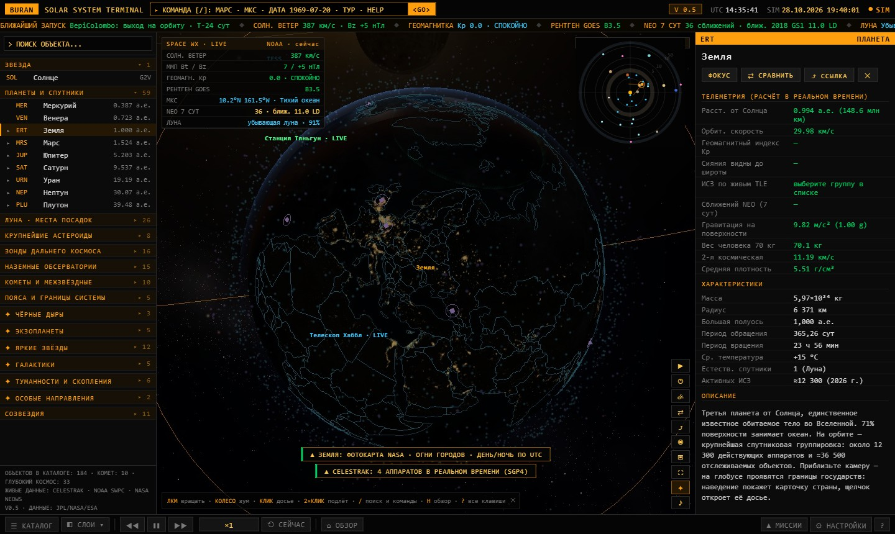
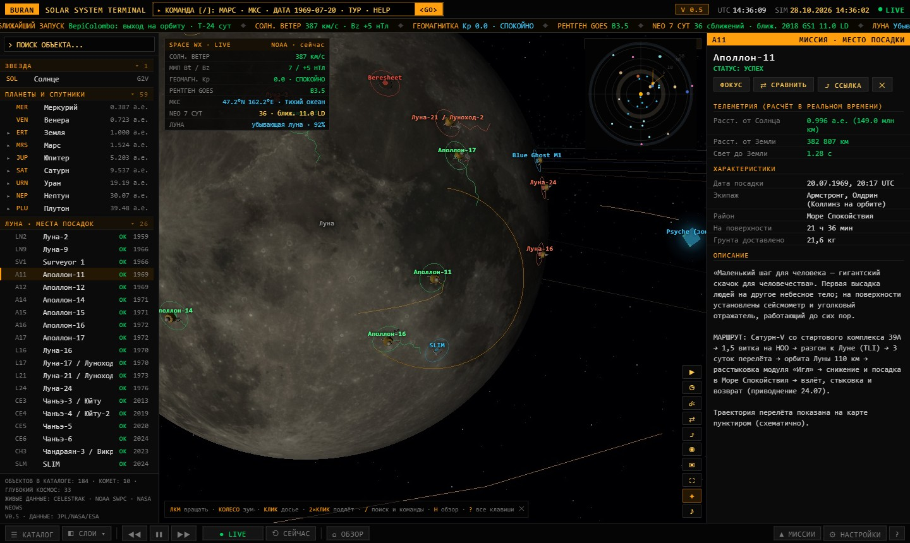
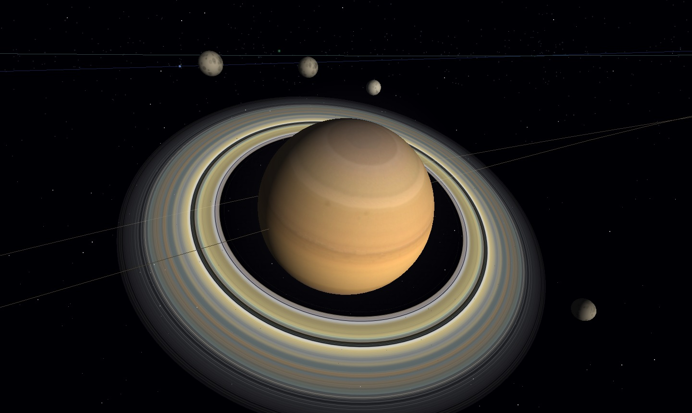
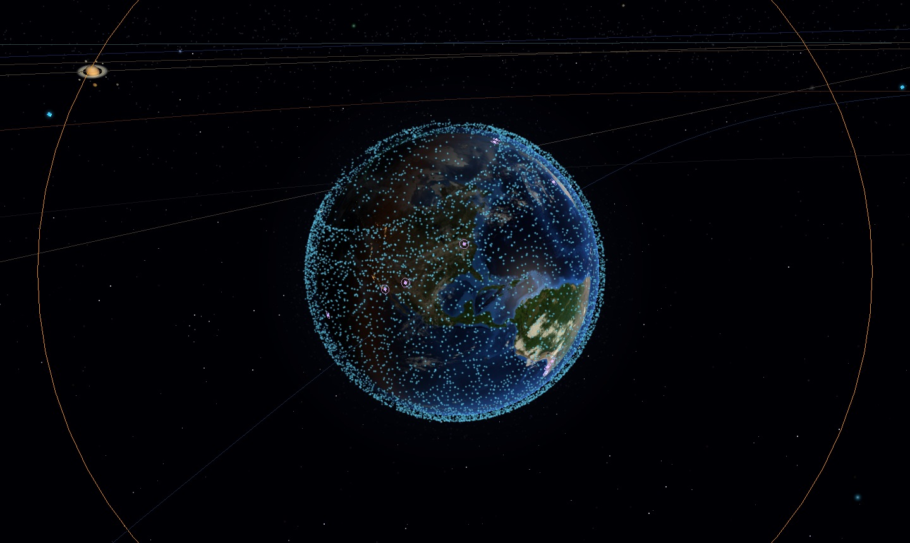
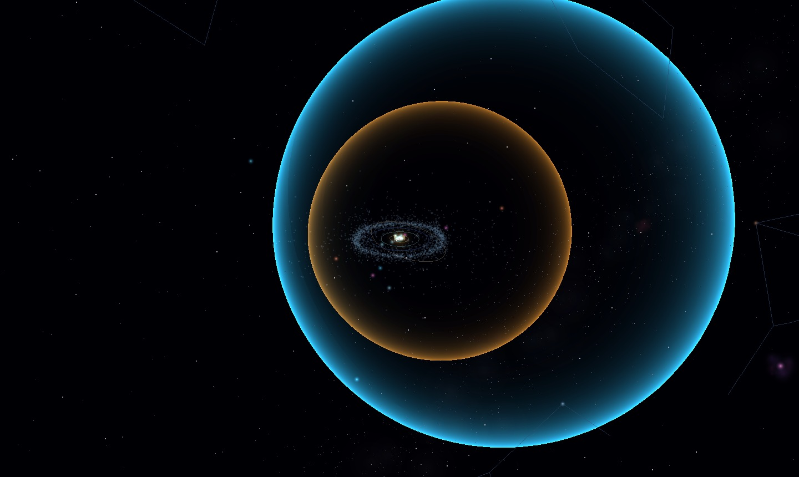
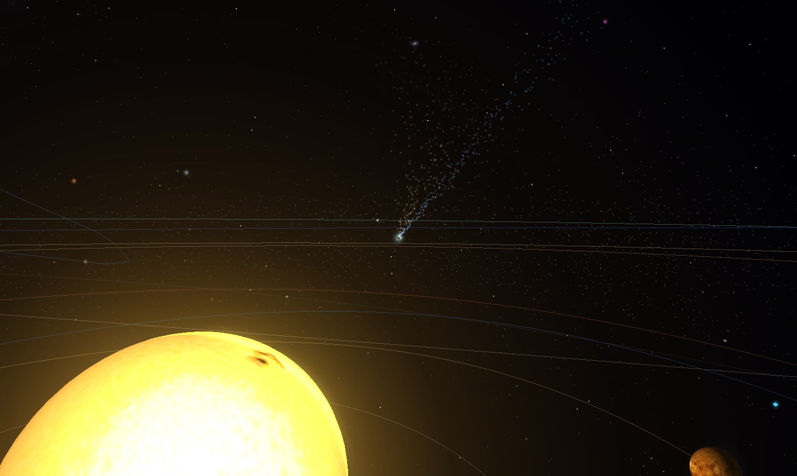

# BURAN GALAXY — живая 3D-карта Солнечной системы

> [!WARNING]
> **Не открывается GitHub Pages?** У части провайдеров (в том числе российских) адреса `*.github.io` недоступны: страница бесконечно грузится или выдаёт ошибку соединения. Сам сайт при этом работает.
>
> **Откройте карту через зеркало:** [**raw.githack.com/…/BURAN_GALAXY/main/index.html**](https://raw.githack.com/greenredapple1910-arch/BURAN_GALAXY/main/index.html). Это тот же `index.html` из этого репозитория. При первом заходе нажмите «Open the page» на промежуточной странице.
>
> Основной адрес: https://greenredapple1910-arch.github.io/BURAN_GALAXY/

**Открытая интерактивная карта Солнечной системы в реальном времени.** Главное в ней — все рукотворные миссии человечества: каждый спутник Земли (точку можно выбрать и прочитать досье), история всех орбитальных запусков с 1957 года, межпланетные зонды и луноходы. Плюс планеты, кометы и космическая погода — по данным CelesTrak, Flight Atlas, NASA и NOAA. Интерфейс в стиле Bloomberg-терминала, графика в духе Universe Sandbox. Один HTML-файл, без сборки и установки.



## Запуск

- **Онлайн:** https://greenredapple1910-arch.github.io/BURAN_GALAXY/
- **Зеркало, если GitHub Pages недоступен:** https://raw.githack.com/greenredapple1910-arch/BURAN_GALAXY/main/index.html (на промежуточной странице нажмите «Open the page»).
- **Локально:** скачайте репозиторий и откройте `index.html` двойным щелчком.
- **Через локальный сервер** (так стабильнее работают живые данные):

  ```bash
  python -m http.server 8000
  ```

  затем откройте <http://localhost:8000>.

При первом запуске нужен интернет: библиотеки, текстуры и живые данные загружаются с CDN и открытых API.

## Что внутри

| | |
|---|---|
|  |  |
|  |  |

**Все спутники Земли (v0.8)**
- **Каталог CelesTrak целиком:** все активные аппараты (Starlink, OneWeb, Kuiper, Qianfan, GPS, ГЛОНАСС, Galileo, BeiDou, геостационар, станции, ДЗЗ, наука), облака обломков (Фэнъюнь-1C, Космос-2251, Iridium 33) и яркие ступени ракет. Положение каждого объекта считается моделью SGP4 прямо в браузере.
- **Весь космический мусор (режим «☄ Мусор»):** около 19 тыс. обломков, ступеней и неработающих спутников. У ~16 тыс. объектов из каталога SATCAT свежих TLE в открытом доступе нет: их орбита (высоты, наклонение, период) известна, а место на ней показано условно — видно, где мусор летает. Категории по событиям: Фэнъюнь-1C, Космос-2251, Iridium 33, Космос-1408, ступень «Чанчжэн-6A» и др. Серая дымка — модель мелких фрагментов, а не реальные объекты.
- **Масштаб как на satellitemap.space:** мелкие чёткие точки, размер зависит от числа объектов и приближения; аппараты в тени Земли тусклые; у Земли узкий угол обзора, почти без перспективных искажений.
- **Каждая точка кликабельна:** наведение — карточка, щелчок — досье. В досье живая телеметрия (координаты, высота, скорость, над какой страной, солнце или тень), параметры орбиты и данные SATCAT (владелец, космодром, дата запуска); на глобусе — орбита, наземная трасса и зона радиовидимости.
- **Ракета и запуск из [Flight Atlas](https://www.flightatlas.org):** рисунок ракеты-носителя, описание пуска, итог, плашка «Посмотреть на Flight Atlas», ссылка на Space Atlas и список всех объектов того же пуска.
- **Список слева:** вкладка «СПУТНИКИ» с поиском по имени, номеру NORAD и коду COSPAR и категориями (Starlink, OneWeb, Kuiper, Qianfan, связь, навигация GPS/ГЛОНАСС/Galileo/BeiDou, геостационар, ДЗЗ) — выбранная категория подсвечивается на карте. Внизу — отдельная вкладка «КОСМИЧЕСКИЙ МУСОР»: облака обломков по событиям (Фэнъюнь-1C, Космос-2251, Iridium 33, Космос-1408) и ступени ракет. Вкладка «ЗАПУСКИ» — все орбитальные пуски с 1957 года со стартовой площадкой на глобусе.
- **Наземная трасса** выбранного спутника начинается точно под ним (пунктирная «нить»): яркая часть — следующий виток, тусклая — прошедшие полвитка; голубой круг — зона радиовидимости. В досье есть пояснение ко всем линиям.
- **Переключатель «Земля / Спутники / Мусор»** (клавиша `G`) поверх карты у Земли: выбирать страны, действующие спутники или космический мусор. При приближении Земля становится «плоской», как на satellitemap.space, и спутники над ней легко выбирать. Двойной щелчок по Земле — подлёт к этой точке; камера не проходит сквозь Землю, Луну и планеты.
- **Вид с МКС** (клавиша `I`): камера на борту станции в реальном времени, кнопка прямого эфира NASA.

**Ближайшие запуски, история орбиты, раскраска (v0.11)**
- **Ближайшие запуски со всего мира** (клавиша `R`): расписание [Launch Library 2](https://thespacedevs.com) с обратным отсчётом, фильтрами по типу и стране, ссылкой на трансляцию; площадки ближайших стартов светятся на глобусе, щелчок — досье запуска.
- **История орбиты 1957 → сейчас** (клавиша `J`): точки вспыхивают в год запуска, счётчик объектов и вехи от «Спутника-1» до Starlink. Обломки появляются в год разрушения, а не в год запуска «родителя».
- **Раскраска спутников** (клавиша `V`): по назначению, стране, году запуска или высоте орбиты; щелчок по строке легенды подсвечивает группу.
- **«Сейчас над»** знает 113 морей и океанов; командная строка `/` ищет по всему каталогу — имя, NORAD, COSPAR, русские названия.
- **Чистое небо:** мягкое свечение Млечного Пути и только яркие звёзды; подписи не налезают друг на друга; размер интерфейса настраивается; на телефоне досье открывается шторкой снизу.

**Живые данные**
- **Станции и телескопы с 3D-моделями:** МКС, Тяньгун, Хаббл, Chandra — по свежим TLE CelesTrak, с наземной трассой и подсказкой, над какой страной аппарат сейчас.
- **Космическая погода NOAA:** солнечный ветер, межпланетное поле, индекс Kp (по нему светятся полярные сияния на глобусе), рентгеновский поток GOES.
- **NEO WATCH:** сближения астероидов с Землёй на неделю (NASA NeoWs).

**Объекты**
- Солнце, 8 планет и Плутон по кеплеровым элементам JPL; 24 крупных спутника; реальная фаза Луны.
- Земля как с орбиты: огни городов, облака, атмосфера; ориентация по звёздному времени, поэтому день, ночь и сезоны совпадают с действительностью. При приближении проявляются границы 180 государств с досье (ВВП, население, столица).
- Границы государств по умолчанию — по законодательству РФ: Республика Крым, Севастополь, ДНР, ЛНР, Запорожская и Херсонская области в составе России. В «⚙ Настройках» можно переключиться на международно признанные границы.
- Луна в HD (мозаика LRO 11469×5734) с 26 местами посадок: аккуратные метки, 3D-модели модулей и луноходов, маршруты луноходов. Траектории миссий — от реального космодрома через опорную орбиту, перелёт и окололунную орбиту точно в место посадки.
- Зонды дальнего космоса, флот у Марса, телескопы JWST, Хаббл, Euclid; наземные обсерватории.
- Кометы с хвостами и межзвёздные объекты 1I/ʻОумуамуа, 2I/Борисов, 3I/ATLAS.
- Пояс астероидов с люками Кирквуда, троянцы Юпитера, пояс Койпера, гелиосфера.
- Небесная сфера: реальный Млечный Путь, созвездия, яркие звёзды, галактики, чёрные дыры Sgr A* и M87*, экзопланетные системы.

**Инструменты**
- Командная строка `/` с автодополнением: «Марс», «Япония», `ДАТА 1969-07-20 20:17`, `ТУР`, `LIVE`.
- Кинотур, машина времени (21 событие от «Спутника-1» до 2134 года), ближайшие запуски и запланированные миссии с обратным отсчётом.
- Сравнение небесных тел, линейка расстояний (Ctrl+щелчок), снимок PNG, ссылки на вид.
- Фоновая музыка — космический эмбиент по свободным лицензиям: начинается сразу и плавно нарастает за 10 секунд; подсвеченная плашка сверху показывает, что играет, и позволяет поставить паузу или выключить звук (`M`).
- Фон неба — фотопанорама Млечного Пути ESO, совмещённая с созвездиями; динамический блик Солнца.
- Управление временем: ускорение до 30 суток в секунду и обратный ход.



## Управление

| Действие | Мышь / клавиша |
|---|---|
| Вращать / приблизить / сдвинуть | ЛКМ / колесо / ПКМ (на телефоне: один палец / два пальца); у Земли ПКМ тоже вращает глобус |
| Подлететь к точке на Земле | двойной щелчок по глобусу |
| Досье объекта / подлёт | щелчок / двойной щелчок |
| Поиск и команды | `/` |
| Обзор всей системы | `H` |
| Медленнее / быстрее (ниже ×1 — назад) | `,` / `.` |
| Пауза | `Пробел` |
| Кинотур / машина времени / NEO / сравнение | `T` / `Y` / `N` / `C` |
| Ближайшие запуски / история орбиты / раскраска спутников | `R` / `J` / `V` |
| У Земли: страны / спутники / мусор | `G` или переключатель внизу карты |
| Вид с МКС | `I` |
| Звук вкл/выкл | `M` |
| Каталог / скрыть интерфейс | `L` / `U` |
| Слои карты | `1`–`6`, `8`, `9`, `0` или меню «◧ СЛОИ» |
| Справка | `?` |

Ссылка вида `index.html#o=saturn&t=2061-07-28T00:00Z` открывает выбранный объект на нужную дату, `#n=25544` — спутник по номеру NORAD, `#l=5651` — запуск из Flight Atlas.

## Как включить GitHub Pages

Settings → Pages → Build and deployment → Source: **Deploy from a branch**, Branch: **main**, папка **/ (root)**. Через минуту карта будет доступна по адресу `https://greenredapple1910-arch.github.io/BURAN_GALAXY/`.

## Устройство проекта

Всё приложение — один файл `index.html`, без сборщиков и зависимостей в репозитории:

1. **Данные** — планеты, спутники, зонды, страны, миссии, места посадок, обсерватории, история версий (`VERSIONS`).
2. **Ядро («часть 2»)** — сцена Three.js r128, орбитальная механика, интерфейс. Наружу открыт объект `window.BURAN` и точки расширения `BURAN.hooks`: `pos`, `post`, `vis`, `live`, `select`, `click`, `key`, `input`, `ticker`, `resize`, `cam`, `pick`.
3. **Модули v0.4 («часть 3»)** — живые данные, кометы, пояса, небо, командная строка, тур, Bloom.
4. **Модуль v0.5 («часть 4»)** — упрощённый интерфейс, настройки, касания, ссылки на вид.
5. **Модуль v0.8 («часть 5»)** — каталог всех спутников Земли, история запусков Flight Atlas, переключатель «Земля / Спутники», телеобъектив, вид с МКС, музыка, обновлённая Луна. Каталог TLE и история запусков кешируются в IndexedDB браузера.
6. **Модуль v0.11 («часть 6»)** — ближайшие запуски (Launch Library 2), история орбиты, раскраска спутников.

Новую функцию проще всего добавить отдельным `<script>` в конце файла через `BURAN.hooks`, не трогая ядро:

```js
BURAN.hooks.post.push((dt) => { /* вызывается каждый кадр после расчёта позиций */ });
BURAN.hooks.live.push((rec, rows) => rows.push(['Моя метрика', () => '42']));
```

## Источники данных и благодарности

- Орбиты планет — элементы JPL (Standish); точность — доли градуса на 1800–2050 гг. Орбиты комет, астероидов и зондов — приближённые.
- TLE и каталог SATCAT — [CelesTrak](https://celestrak.org) (T. S. Kelso), расчёт орбит — [satellite.js](https://github.com/shashwatak/satellite-js) (MIT). CelesTrak отдаёт каждую группу одному адресу не чаще раза в 2 часа, поэтому снимок данных раз в 3 часа сохраняет [GitHub Action](.github/workflows/data.yml) в ветку `data` ([скрипт](tools/data/fetch_data.py)), и карта берёт его через jsDelivr / raw.githack; к CelesTrak напрямую — только если снимка нет. Копия хранится и в браузере.
- Фон неба — [The Milky Way panorama](https://www.eso.org/public/images/eso0932a/), ESO / S. Brunier ([CC BY 4.0](https://creativecommons.org/licenses/by/4.0/)); загружается с сервера ESO.
- История запусков и рисунки ракет — [Flight Atlas](https://www.flightatlas.org). Используются в некоммерческом проекте с указанием источника рядом с каждым рисунком; список запусков загружается один раз и хранится в браузере неделю. Ссылки на [Space Atlas](https://spaceatlas.tech) для пусков.
- Музыка (Wikimedia Commons): Scott Buckley — Where Stars Fall, Celestial, Helios, Signal to Noise, The Distant Sun, Ephemera, Luminance, Echoes Of Home, Born Of The Sky, Eyes In The Void ([CC BY 4.0](https://creativecommons.org/licenses/by/4.0/), [scottbuckley.com.au](https://www.scottbuckley.com.au)); Dreamstate Logic — Zero Point ([CC BY 3.0](https://creativecommons.org/licenses/by/3.0/)); John Bartmann — Interstellar Space ([CC0](https://creativecommons.org/publicdomain/zero/1.0/)). Файлы проигрываются с серверов Commons и в репозитории не хранятся.
- Ближайшие запуски — [Launch Library 2](https://thespacedevs.com), The Space Devs; снимок расписания раз в 3 часа сохраняет тот же GitHub Action, что и TLE.
- Моря и океаны для «Сейчас над» — [Natural Earth](https://www.naturalearthdata.com) 1:50m marine polygons (общественное достояние), сборка — [tools/seas](tools/seas/build_seas.py).
- Прямой эфир с МКС — [NASA](https://www.nasa.gov/live/) (YouTube).
- Космическая погода — [NOAA SWPC](https://www.swpc.noaa.gov) (общественное достояние).
- Сближения астероидов — [NASA NeoWs](https://api.nasa.gov) (публичный ключ `DEMO_KEY`, до 30 запросов в час).
- Границы государств — [Natural Earth](https://www.naturalearthdata.com) через [world.geo.json](https://github.com/johan/world.geo.json) (общественное достояние); границы регионов для режима «по законодательству РФ» — Natural Earth admin-1 1:10M, скрипты сборки в [tools/borders](tools/borders).
- Текстуры Земли — NASA Blue Marble и Black Marble (через примеры [three-globe](https://github.com/vasturiano/three-globe) и three.js); HD-карта Луны — NASA LRO (через пример [globe.gl](https://github.com/vasturiano/globe.gl)).
- Текстуры планет — © James Hastings-Trew, [Planet Pixel Emporium](http://planetpixelemporium.com), через [threex.planets](https://github.com/jeromeetienne/threex.planets); используются по условиям автора и загружаются с CDN, в репозитории не хранятся.
- 3D-движок — [three.js](https://threejs.org) r128 (MIT).

Все внешние ресурсы подгружаются во время работы и не входят в репозиторий; их лицензии действуют отдельно от лицензии проекта.

## Участие

Пул-реквесты и идеи приветствуются: новые миссии, переводы интерфейса, уточнение данных, оптимизация. Перед отправкой откройте `index.html` и убедитесь, что в консоли браузера нет ошибок. Историю изменений см. в [CHANGELOG.md](CHANGELOG.md) или в самом приложении (бейдж версии в правом верхнем углу).

## Лицензия

Код проекта распространяется по лицензии [MIT](LICENSE).

---

## English summary

**BURAN GALAXY** is an open-source, real-time 3D map of the Solar System in a single HTML file: planets and moons from JPL orbital elements, a photoreal Earth with city lights and a true day/night terminator, an HD Moon with 26 landing sites, the full CelesTrak catalogue of Earth satellites, debris and rocket bodies propagated with SGP4 (every point is clickable, with a dossier that includes live telemetry, SATCAT data and the launch vehicle drawing and launch description from Flight Atlas), the history of every orbital launch since 1957, an ISS live view, NOAA space weather with Kp-driven aurorae, NASA near-Earth asteroid approaches, comets with tails, interstellar objects, asteroid and Kuiper belts, the heliosphere and a real celestial sphere. The interface is in Russian and styled after a Bloomberg terminal. Open `index.html` in a browser (internet connection required for libraries, textures and live data). Licensed under MIT.

Live: https://greenredapple1910-arch.github.io/BURAN_GALAXY/ · Mirror (if `*.github.io` is blocked on your network): https://raw.githack.com/greenredapple1910-arch/BURAN_GALAXY/main/index.html
